# Packing pilot evaluation

Local baseline improvements only; no world records established. Baselines are certified reconstructions, not original full-precision incumbents. Exact replay and ranking use selected certificates, never numeric_best. CPU hours are recorded search cost only and exclude certification; failed runs with unavailable CPU accounting are counted separately, not assumed to have cost zero. Summed certification wall hours are not CPU hours. Medians condition on valid runs; missing and failures remain visible. SVGs use floating-point rendering only. Recovery and meaningful improvement thresholds follow manifest.metrics (defaults 1e-5 and 1e-6). Success rates include failed completed runs as nonsuccesses and exclude missing runs. Wilson intervals are descriptive marginal intervals; common seeds pair arms, so these intervals do not test arm differences. Warm runs retain the exact baseline as a fallback: warm recovery is guaranteed by retention when certification succeeds, not evidence of rediscovery. Selected-baseline counts identify the unchanged witness; equal-baseline-bound counts also include other witnesses with exactly the same size.

Tasks: 1200; independently replayed valid: 18; missing: 1182; failed or unverified: 0. Recorded search CPU hours: 0.6000; completed tasks with unknown search CPU cost: 0.

| Case | Derived baseline | Best certified | Baseline − best | Source claim comparison |
|---|---:|---:|---:|---|
| square_circle_n11 | 2.21386685696 | 2.21386684614 | 1.08280000000e-8 | within_reported_precision_interval |
| square_circle_n13 | 2.36070755549 | — | — | unavailable |
| square_triangle_n12 | 6.30122136300 | — | — | unavailable |
| square_triangle_n8 | 5.30122134141 | — | — | unavailable |
| square_circle_n15 | 2.53313897016 | — | — | unavailable |
| square_circle_n18 | 2.74146403341 | — | — | unavailable |
| square_circle_n20 | 2.89355372334 | — | — | unavailable |
| square_triangle_n17 | 7.30122136177 | — | — | unavailable |
| square_triangle_n23 | 8.30122134281 | — | — | unavailable |
| square_triangle_n30 | 9.30122140342 | — | — | unavailable |

## square_circle_n11

Exact baseline minus best: `2707/250000000000`. Positive means a smaller certified local container. Thresholds: recovery +0.00001, meaningful improvement −0.000001, relative to baseline. Rate cells show success/completed, percent, and 95% Wilson interval.

| Arm | Start | Valid / tasks | Missing | Valid-run median | CPU hours | Recovery rate | Meaningful improvement rate | Strict exact improvements |
|---|---|---:|---:|---:|---:|---|---|---:|
| rigid | fresh | 12 / 12 | 0 | 2.21386684614 | 0.4000 | 12/12 (100.0%; 75.8–100.0%) | 0/12 (0.0%; 0.0–24.2%) | 12 |
| rigid | warm | 6 / 12 | 6 | 2.21386684614 | 0.2000 | 6/6 (100.0%; 61.0–100.0%) | 0/6 (0.0%; 0.0–39.0%) | 6 |
| basin | fresh | 0 / 12 | 12 | — | 0.0000 | — | — | 0 |
| basin | warm | 0 / 12 | 12 | — | 0.0000 | — | — | 0 |
| anneal | fresh | 0 / 12 | 12 | — | 0.0000 | — | — | 0 |
| anneal | warm | 0 / 12 | 12 | — | 0.0000 | — | — | 0 |
| homotopy | fresh | 0 / 12 | 12 | — | 0.0000 | — | — | 0 |
| homotopy | warm | 0 / 12 | 12 | — | 0.0000 | — | — | 0 |
| structured | fresh | 0 / 12 | 12 | — | 0.0000 | — | — | 0 |
| structured | warm | 0 / 12 | 12 | — | 0.0000 | — | — | 0 |

| Arm / start | Selected unchanged witness | Equal baseline bound | Unknown search CPU cost |
|---|---:|---:|---:|
| rigid / fresh | 0 | 0 | 0 |
| rigid / warm | 0 | 0 | 0 |
| basin / fresh | 0 | 0 | 0 |
| basin / warm | 0 | 0 | 0 |
| anneal / fresh | 0 | 0 | 0 |
| anneal / warm | 0 | 0 | 0 |
| homotopy / fresh | 0 | 0 | 0 |
| homotopy / warm | 0 | 0 | 0 |
| structured / fresh | 0 | 0 | 0 |
| structured / warm | 0 | 0 | 0 |

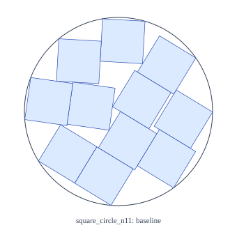 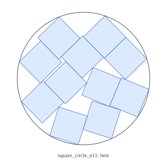

## square_circle_n13

Exact baseline minus best: `unavailable`. Positive means a smaller certified local container. Thresholds: recovery +0.00001, meaningful improvement −0.000001, relative to baseline. Rate cells show success/completed, percent, and 95% Wilson interval.

| Arm | Start | Valid / tasks | Missing | Valid-run median | CPU hours | Recovery rate | Meaningful improvement rate | Strict exact improvements |
|---|---|---:|---:|---:|---:|---|---|---:|
| rigid | fresh | 0 / 12 | 12 | — | 0.0000 | — | — | 0 |
| rigid | warm | 0 / 12 | 12 | — | 0.0000 | — | — | 0 |
| basin | fresh | 0 / 12 | 12 | — | 0.0000 | — | — | 0 |
| basin | warm | 0 / 12 | 12 | — | 0.0000 | — | — | 0 |
| anneal | fresh | 0 / 12 | 12 | — | 0.0000 | — | — | 0 |
| anneal | warm | 0 / 12 | 12 | — | 0.0000 | — | — | 0 |
| homotopy | fresh | 0 / 12 | 12 | — | 0.0000 | — | — | 0 |
| homotopy | warm | 0 / 12 | 12 | — | 0.0000 | — | — | 0 |
| structured | fresh | 0 / 12 | 12 | — | 0.0000 | — | — | 0 |
| structured | warm | 0 / 12 | 12 | — | 0.0000 | — | — | 0 |

| Arm / start | Selected unchanged witness | Equal baseline bound | Unknown search CPU cost |
|---|---:|---:|---:|
| rigid / fresh | 0 | 0 | 0 |
| rigid / warm | 0 | 0 | 0 |
| basin / fresh | 0 | 0 | 0 |
| basin / warm | 0 | 0 | 0 |
| anneal / fresh | 0 | 0 | 0 |
| anneal / warm | 0 | 0 | 0 |
| homotopy / fresh | 0 | 0 | 0 |
| homotopy / warm | 0 | 0 | 0 |
| structured / fresh | 0 | 0 | 0 |
| structured / warm | 0 | 0 | 0 |

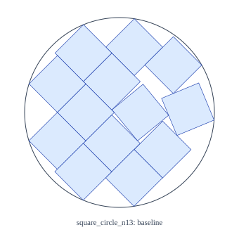 

## square_triangle_n12

Exact baseline minus best: `unavailable`. Positive means a smaller certified local container. Thresholds: recovery +0.00001, meaningful improvement −0.000001, relative to baseline. Rate cells show success/completed, percent, and 95% Wilson interval.

| Arm | Start | Valid / tasks | Missing | Valid-run median | CPU hours | Recovery rate | Meaningful improvement rate | Strict exact improvements |
|---|---|---:|---:|---:|---:|---|---|---:|
| rigid | fresh | 0 / 12 | 12 | — | 0.0000 | — | — | 0 |
| rigid | warm | 0 / 12 | 12 | — | 0.0000 | — | — | 0 |
| basin | fresh | 0 / 12 | 12 | — | 0.0000 | — | — | 0 |
| basin | warm | 0 / 12 | 12 | — | 0.0000 | — | — | 0 |
| anneal | fresh | 0 / 12 | 12 | — | 0.0000 | — | — | 0 |
| anneal | warm | 0 / 12 | 12 | — | 0.0000 | — | — | 0 |
| homotopy | fresh | 0 / 12 | 12 | — | 0.0000 | — | — | 0 |
| homotopy | warm | 0 / 12 | 12 | — | 0.0000 | — | — | 0 |
| structured | fresh | 0 / 12 | 12 | — | 0.0000 | — | — | 0 |
| structured | warm | 0 / 12 | 12 | — | 0.0000 | — | — | 0 |

| Arm / start | Selected unchanged witness | Equal baseline bound | Unknown search CPU cost |
|---|---:|---:|---:|
| rigid / fresh | 0 | 0 | 0 |
| rigid / warm | 0 | 0 | 0 |
| basin / fresh | 0 | 0 | 0 |
| basin / warm | 0 | 0 | 0 |
| anneal / fresh | 0 | 0 | 0 |
| anneal / warm | 0 | 0 | 0 |
| homotopy / fresh | 0 | 0 | 0 |
| homotopy / warm | 0 | 0 | 0 |
| structured / fresh | 0 | 0 | 0 |
| structured / warm | 0 | 0 | 0 |

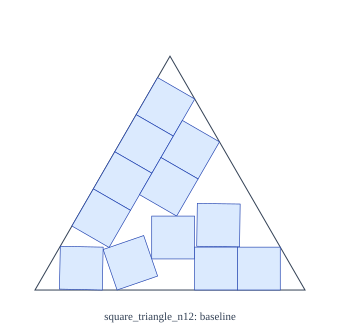 

## square_triangle_n8

Exact baseline minus best: `unavailable`. Positive means a smaller certified local container. Thresholds: recovery +0.00001, meaningful improvement −0.000001, relative to baseline. Rate cells show success/completed, percent, and 95% Wilson interval.

| Arm | Start | Valid / tasks | Missing | Valid-run median | CPU hours | Recovery rate | Meaningful improvement rate | Strict exact improvements |
|---|---|---:|---:|---:|---:|---|---|---:|
| rigid | fresh | 0 / 12 | 12 | — | 0.0000 | — | — | 0 |
| rigid | warm | 0 / 12 | 12 | — | 0.0000 | — | — | 0 |
| basin | fresh | 0 / 12 | 12 | — | 0.0000 | — | — | 0 |
| basin | warm | 0 / 12 | 12 | — | 0.0000 | — | — | 0 |
| anneal | fresh | 0 / 12 | 12 | — | 0.0000 | — | — | 0 |
| anneal | warm | 0 / 12 | 12 | — | 0.0000 | — | — | 0 |
| homotopy | fresh | 0 / 12 | 12 | — | 0.0000 | — | — | 0 |
| homotopy | warm | 0 / 12 | 12 | — | 0.0000 | — | — | 0 |
| structured | fresh | 0 / 12 | 12 | — | 0.0000 | — | — | 0 |
| structured | warm | 0 / 12 | 12 | — | 0.0000 | — | — | 0 |

| Arm / start | Selected unchanged witness | Equal baseline bound | Unknown search CPU cost |
|---|---:|---:|---:|
| rigid / fresh | 0 | 0 | 0 |
| rigid / warm | 0 | 0 | 0 |
| basin / fresh | 0 | 0 | 0 |
| basin / warm | 0 | 0 | 0 |
| anneal / fresh | 0 | 0 | 0 |
| anneal / warm | 0 | 0 | 0 |
| homotopy / fresh | 0 | 0 | 0 |
| homotopy / warm | 0 | 0 | 0 |
| structured / fresh | 0 | 0 | 0 |
| structured / warm | 0 | 0 | 0 |

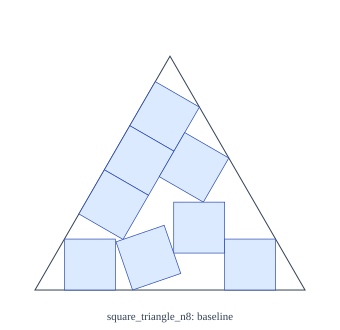 

## square_circle_n15

Exact baseline minus best: `unavailable`. Positive means a smaller certified local container. Thresholds: recovery +0.00001, meaningful improvement −0.000001, relative to baseline. Rate cells show success/completed, percent, and 95% Wilson interval.

| Arm | Start | Valid / tasks | Missing | Valid-run median | CPU hours | Recovery rate | Meaningful improvement rate | Strict exact improvements |
|---|---|---:|---:|---:|---:|---|---|---:|
| rigid | fresh | 0 / 12 | 12 | — | 0.0000 | — | — | 0 |
| rigid | warm | 0 / 12 | 12 | — | 0.0000 | — | — | 0 |
| basin | fresh | 0 / 12 | 12 | — | 0.0000 | — | — | 0 |
| basin | warm | 0 / 12 | 12 | — | 0.0000 | — | — | 0 |
| anneal | fresh | 0 / 12 | 12 | — | 0.0000 | — | — | 0 |
| anneal | warm | 0 / 12 | 12 | — | 0.0000 | — | — | 0 |
| homotopy | fresh | 0 / 12 | 12 | — | 0.0000 | — | — | 0 |
| homotopy | warm | 0 / 12 | 12 | — | 0.0000 | — | — | 0 |
| structured | fresh | 0 / 12 | 12 | — | 0.0000 | — | — | 0 |
| structured | warm | 0 / 12 | 12 | — | 0.0000 | — | — | 0 |

| Arm / start | Selected unchanged witness | Equal baseline bound | Unknown search CPU cost |
|---|---:|---:|---:|
| rigid / fresh | 0 | 0 | 0 |
| rigid / warm | 0 | 0 | 0 |
| basin / fresh | 0 | 0 | 0 |
| basin / warm | 0 | 0 | 0 |
| anneal / fresh | 0 | 0 | 0 |
| anneal / warm | 0 | 0 | 0 |
| homotopy / fresh | 0 | 0 | 0 |
| homotopy / warm | 0 | 0 | 0 |
| structured / fresh | 0 | 0 | 0 |
| structured / warm | 0 | 0 | 0 |

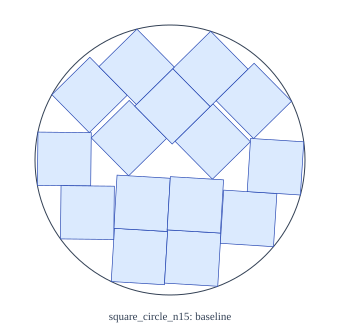 

## square_circle_n18

Exact baseline minus best: `unavailable`. Positive means a smaller certified local container. Thresholds: recovery +0.00001, meaningful improvement −0.000001, relative to baseline. Rate cells show success/completed, percent, and 95% Wilson interval.

| Arm | Start | Valid / tasks | Missing | Valid-run median | CPU hours | Recovery rate | Meaningful improvement rate | Strict exact improvements |
|---|---|---:|---:|---:|---:|---|---|---:|
| rigid | fresh | 0 / 12 | 12 | — | 0.0000 | — | — | 0 |
| rigid | warm | 0 / 12 | 12 | — | 0.0000 | — | — | 0 |
| basin | fresh | 0 / 12 | 12 | — | 0.0000 | — | — | 0 |
| basin | warm | 0 / 12 | 12 | — | 0.0000 | — | — | 0 |
| anneal | fresh | 0 / 12 | 12 | — | 0.0000 | — | — | 0 |
| anneal | warm | 0 / 12 | 12 | — | 0.0000 | — | — | 0 |
| homotopy | fresh | 0 / 12 | 12 | — | 0.0000 | — | — | 0 |
| homotopy | warm | 0 / 12 | 12 | — | 0.0000 | — | — | 0 |
| structured | fresh | 0 / 12 | 12 | — | 0.0000 | — | — | 0 |
| structured | warm | 0 / 12 | 12 | — | 0.0000 | — | — | 0 |

| Arm / start | Selected unchanged witness | Equal baseline bound | Unknown search CPU cost |
|---|---:|---:|---:|
| rigid / fresh | 0 | 0 | 0 |
| rigid / warm | 0 | 0 | 0 |
| basin / fresh | 0 | 0 | 0 |
| basin / warm | 0 | 0 | 0 |
| anneal / fresh | 0 | 0 | 0 |
| anneal / warm | 0 | 0 | 0 |
| homotopy / fresh | 0 | 0 | 0 |
| homotopy / warm | 0 | 0 | 0 |
| structured / fresh | 0 | 0 | 0 |
| structured / warm | 0 | 0 | 0 |

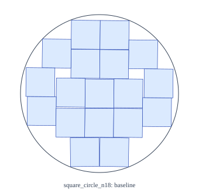 

## square_circle_n20

Exact baseline minus best: `unavailable`. Positive means a smaller certified local container. Thresholds: recovery +0.00001, meaningful improvement −0.000001, relative to baseline. Rate cells show success/completed, percent, and 95% Wilson interval.

| Arm | Start | Valid / tasks | Missing | Valid-run median | CPU hours | Recovery rate | Meaningful improvement rate | Strict exact improvements |
|---|---|---:|---:|---:|---:|---|---|---:|
| rigid | fresh | 0 / 12 | 12 | — | 0.0000 | — | — | 0 |
| rigid | warm | 0 / 12 | 12 | — | 0.0000 | — | — | 0 |
| basin | fresh | 0 / 12 | 12 | — | 0.0000 | — | — | 0 |
| basin | warm | 0 / 12 | 12 | — | 0.0000 | — | — | 0 |
| anneal | fresh | 0 / 12 | 12 | — | 0.0000 | — | — | 0 |
| anneal | warm | 0 / 12 | 12 | — | 0.0000 | — | — | 0 |
| homotopy | fresh | 0 / 12 | 12 | — | 0.0000 | — | — | 0 |
| homotopy | warm | 0 / 12 | 12 | — | 0.0000 | — | — | 0 |
| structured | fresh | 0 / 12 | 12 | — | 0.0000 | — | — | 0 |
| structured | warm | 0 / 12 | 12 | — | 0.0000 | — | — | 0 |

| Arm / start | Selected unchanged witness | Equal baseline bound | Unknown search CPU cost |
|---|---:|---:|---:|
| rigid / fresh | 0 | 0 | 0 |
| rigid / warm | 0 | 0 | 0 |
| basin / fresh | 0 | 0 | 0 |
| basin / warm | 0 | 0 | 0 |
| anneal / fresh | 0 | 0 | 0 |
| anneal / warm | 0 | 0 | 0 |
| homotopy / fresh | 0 | 0 | 0 |
| homotopy / warm | 0 | 0 | 0 |
| structured / fresh | 0 | 0 | 0 |
| structured / warm | 0 | 0 | 0 |

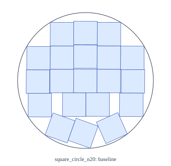 

## square_triangle_n17

Exact baseline minus best: `unavailable`. Positive means a smaller certified local container. Thresholds: recovery +0.00001, meaningful improvement −0.000001, relative to baseline. Rate cells show success/completed, percent, and 95% Wilson interval.

| Arm | Start | Valid / tasks | Missing | Valid-run median | CPU hours | Recovery rate | Meaningful improvement rate | Strict exact improvements |
|---|---|---:|---:|---:|---:|---|---|---:|
| rigid | fresh | 0 / 12 | 12 | — | 0.0000 | — | — | 0 |
| rigid | warm | 0 / 12 | 12 | — | 0.0000 | — | — | 0 |
| basin | fresh | 0 / 12 | 12 | — | 0.0000 | — | — | 0 |
| basin | warm | 0 / 12 | 12 | — | 0.0000 | — | — | 0 |
| anneal | fresh | 0 / 12 | 12 | — | 0.0000 | — | — | 0 |
| anneal | warm | 0 / 12 | 12 | — | 0.0000 | — | — | 0 |
| homotopy | fresh | 0 / 12 | 12 | — | 0.0000 | — | — | 0 |
| homotopy | warm | 0 / 12 | 12 | — | 0.0000 | — | — | 0 |
| structured | fresh | 0 / 12 | 12 | — | 0.0000 | — | — | 0 |
| structured | warm | 0 / 12 | 12 | — | 0.0000 | — | — | 0 |

| Arm / start | Selected unchanged witness | Equal baseline bound | Unknown search CPU cost |
|---|---:|---:|---:|
| rigid / fresh | 0 | 0 | 0 |
| rigid / warm | 0 | 0 | 0 |
| basin / fresh | 0 | 0 | 0 |
| basin / warm | 0 | 0 | 0 |
| anneal / fresh | 0 | 0 | 0 |
| anneal / warm | 0 | 0 | 0 |
| homotopy / fresh | 0 | 0 | 0 |
| homotopy / warm | 0 | 0 | 0 |
| structured / fresh | 0 | 0 | 0 |
| structured / warm | 0 | 0 | 0 |

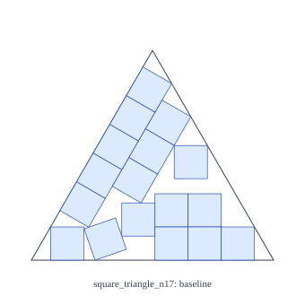 

## square_triangle_n23

Exact baseline minus best: `unavailable`. Positive means a smaller certified local container. Thresholds: recovery +0.00001, meaningful improvement −0.000001, relative to baseline. Rate cells show success/completed, percent, and 95% Wilson interval.

| Arm | Start | Valid / tasks | Missing | Valid-run median | CPU hours | Recovery rate | Meaningful improvement rate | Strict exact improvements |
|---|---|---:|---:|---:|---:|---|---|---:|
| rigid | fresh | 0 / 12 | 12 | — | 0.0000 | — | — | 0 |
| rigid | warm | 0 / 12 | 12 | — | 0.0000 | — | — | 0 |
| basin | fresh | 0 / 12 | 12 | — | 0.0000 | — | — | 0 |
| basin | warm | 0 / 12 | 12 | — | 0.0000 | — | — | 0 |
| anneal | fresh | 0 / 12 | 12 | — | 0.0000 | — | — | 0 |
| anneal | warm | 0 / 12 | 12 | — | 0.0000 | — | — | 0 |
| homotopy | fresh | 0 / 12 | 12 | — | 0.0000 | — | — | 0 |
| homotopy | warm | 0 / 12 | 12 | — | 0.0000 | — | — | 0 |
| structured | fresh | 0 / 12 | 12 | — | 0.0000 | — | — | 0 |
| structured | warm | 0 / 12 | 12 | — | 0.0000 | — | — | 0 |

| Arm / start | Selected unchanged witness | Equal baseline bound | Unknown search CPU cost |
|---|---:|---:|---:|
| rigid / fresh | 0 | 0 | 0 |
| rigid / warm | 0 | 0 | 0 |
| basin / fresh | 0 | 0 | 0 |
| basin / warm | 0 | 0 | 0 |
| anneal / fresh | 0 | 0 | 0 |
| anneal / warm | 0 | 0 | 0 |
| homotopy / fresh | 0 | 0 | 0 |
| homotopy / warm | 0 | 0 | 0 |
| structured / fresh | 0 | 0 | 0 |
| structured / warm | 0 | 0 | 0 |

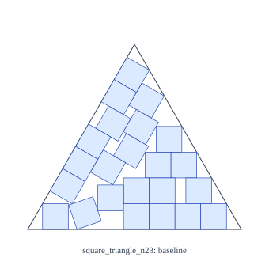 

## square_triangle_n30

Exact baseline minus best: `unavailable`. Positive means a smaller certified local container. Thresholds: recovery +0.00001, meaningful improvement −0.000001, relative to baseline. Rate cells show success/completed, percent, and 95% Wilson interval.

| Arm | Start | Valid / tasks | Missing | Valid-run median | CPU hours | Recovery rate | Meaningful improvement rate | Strict exact improvements |
|---|---|---:|---:|---:|---:|---|---|---:|
| rigid | fresh | 0 / 12 | 12 | — | 0.0000 | — | — | 0 |
| rigid | warm | 0 / 12 | 12 | — | 0.0000 | — | — | 0 |
| basin | fresh | 0 / 12 | 12 | — | 0.0000 | — | — | 0 |
| basin | warm | 0 / 12 | 12 | — | 0.0000 | — | — | 0 |
| anneal | fresh | 0 / 12 | 12 | — | 0.0000 | — | — | 0 |
| anneal | warm | 0 / 12 | 12 | — | 0.0000 | — | — | 0 |
| homotopy | fresh | 0 / 12 | 12 | — | 0.0000 | — | — | 0 |
| homotopy | warm | 0 / 12 | 12 | — | 0.0000 | — | — | 0 |
| structured | fresh | 0 / 12 | 12 | — | 0.0000 | — | — | 0 |
| structured | warm | 0 / 12 | 12 | — | 0.0000 | — | — | 0 |

| Arm / start | Selected unchanged witness | Equal baseline bound | Unknown search CPU cost |
|---|---:|---:|---:|
| rigid / fresh | 0 | 0 | 0 |
| rigid / warm | 0 | 0 | 0 |
| basin / fresh | 0 | 0 | 0 |
| basin / warm | 0 | 0 | 0 |
| anneal / fresh | 0 | 0 | 0 |
| anneal / warm | 0 | 0 | 0 |
| homotopy / fresh | 0 | 0 | 0 |
| homotopy / warm | 0 | 0 | 0 |
| structured / fresh | 0 | 0 | 0 |
| structured / warm | 0 | 0 | 0 |

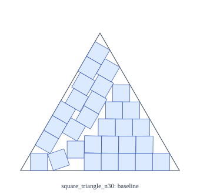 
