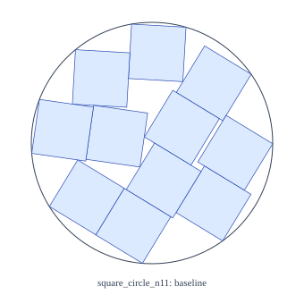
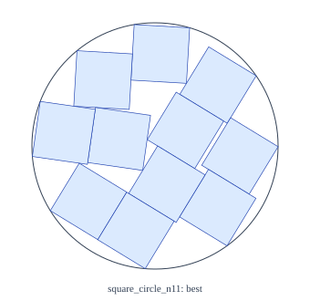
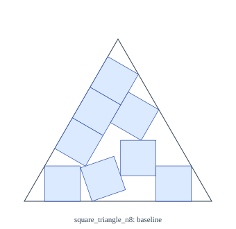
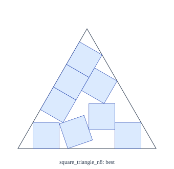

# Packing pilot evaluation

Local baseline improvements only; no world records established. Baselines are certified reconstructions, not original full-precision incumbents. Exact replay and ranking use selected certificates, never numeric_best. CPU hours exclude certification; summed certification wall hours are not CPU hours. Medians condition on valid runs; missing and failures remain visible. SVGs use floating-point rendering only. Recovery and meaningful improvement thresholds follow manifest.metrics (defaults 1e-5 and 1e-6). Success rates include failed completed runs as nonsuccesses and exclude missing runs. Wilson intervals are descriptive marginal intervals; common seeds pair arms, so these intervals do not test arm differences. Baseline index was read from the live baseline directory; archive this report and its referenced certificates before baselines change.

Tasks: 10; independently replayed valid: 10; missing: 0; failed or unverified: 0. Search CPU hours: 0.0111.

| Case | Derived baseline | Best certified | Baseline − best | Source claim comparison |
|---|---:|---:|---:|---|
| square_circle_n11 | 2.21386685696 | 2.21386685239 | 4.57500000000e-9 | within_reported_precision_interval |
| square_triangle_n8 | 5.30122134141 | 5.30122133202 | 9.38700000000e-9 | within_reported_precision_interval |

## square_circle_n11

Exact baseline minus best: `183/40000000000`. Positive means a smaller certified local container. Thresholds: recovery +0.00001, meaningful improvement −0.000001, relative to baseline. Rate cells show success/completed, percent, and 95% Wilson interval.

| Arm | Start | Valid / tasks | Missing | Valid-run median | CPU hours | Recovery rate | Meaningful improvement rate | Strict exact improvements |
|---|---|---:|---:|---:|---:|---|---|---:|
| rigid | warm | 1 / 1 | 0 | 2.21386685239 | 0.0011 | 1/1 (100.0%; 20.7–100.0%) | 0/1 (0.0%; 0.0–79.3%) | 1 |
| basin | warm | 1 / 1 | 0 | 2.21386685239 | 0.0011 | 1/1 (100.0%; 20.7–100.0%) | 0/1 (0.0%; 0.0–79.3%) | 1 |
| anneal | warm | 1 / 1 | 0 | 2.21386685239 | 0.0011 | 1/1 (100.0%; 20.7–100.0%) | 0/1 (0.0%; 0.0–79.3%) | 1 |
| homotopy | warm | 1 / 1 | 0 | 2.21386685696 | 0.0011 | 1/1 (100.0%; 20.7–100.0%) | 0/1 (0.0%; 0.0–79.3%) | 0 |
| structured | warm | 1 / 1 | 0 | 2.21386685239 | 0.0011 | 1/1 (100.0%; 20.7–100.0%) | 0/1 (0.0%; 0.0–79.3%) | 1 |

 

## square_triangle_n8

Exact baseline minus best: `9387/1000000000000`. Positive means a smaller certified local container. Thresholds: recovery +0.00001, meaningful improvement −0.000001, relative to baseline. Rate cells show success/completed, percent, and 95% Wilson interval.

| Arm | Start | Valid / tasks | Missing | Valid-run median | CPU hours | Recovery rate | Meaningful improvement rate | Strict exact improvements |
|---|---|---:|---:|---:|---:|---|---|---:|
| rigid | warm | 1 / 1 | 0 | 5.30122133202 | 0.0011 | 1/1 (100.0%; 20.7–100.0%) | 0/1 (0.0%; 0.0–79.3%) | 1 |
| basin | warm | 1 / 1 | 0 | 5.30122133202 | 0.0011 | 1/1 (100.0%; 20.7–100.0%) | 0/1 (0.0%; 0.0–79.3%) | 1 |
| anneal | warm | 1 / 1 | 0 | 5.30122133202 | 0.0011 | 1/1 (100.0%; 20.7–100.0%) | 0/1 (0.0%; 0.0–79.3%) | 1 |
| homotopy | warm | 1 / 1 | 0 | 5.30122133299 | 0.0011 | 1/1 (100.0%; 20.7–100.0%) | 0/1 (0.0%; 0.0–79.3%) | 1 |
| structured | warm | 1 / 1 | 0 | 5.30122133202 | 0.0011 | 1/1 (100.0%; 20.7–100.0%) | 0/1 (0.0%; 0.0–79.3%) | 1 |

 
