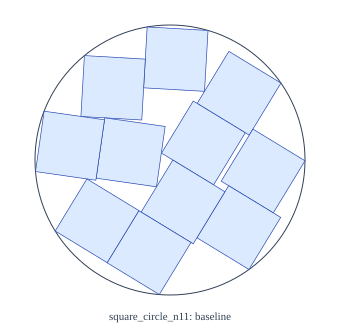
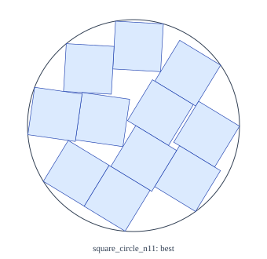
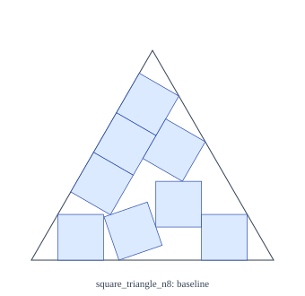
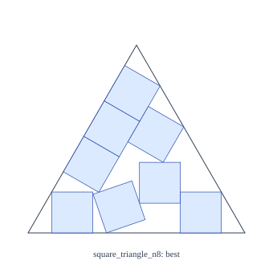

# Packing pilot evaluation

Local baseline improvements only; no world records established. Baselines are certified reconstructions, not original full-precision incumbents. Exact replay and ranking use selected certificates, never numeric_best. CPU hours exclude certification; summed certification wall hours are not CPU hours. Medians condition on valid runs; missing and failures remain visible. SVGs use floating-point rendering only.

Tasks: 10; independently replayed valid: 10; missing: 0; failed or unverified: 0. Search CPU hours: 0.0111.

| Case | Derived baseline | Best certified | Baseline − best | Source claim comparison |
|---|---:|---:|---:|---|
| square_circle_n11 | 2.21386685696 | 2.21386684614 | 1.08280000000e-8 | within_reported_precision_interval |
| square_triangle_n8 | 5.30122134141 | 5.30122133140 | 1.00090000000e-8 | within_reported_precision_interval |

## square_circle_n11

Exact baseline minus best: `2707/250000000000`. Positive means a smaller certified local container.

| Arm | Start | Valid / tasks | Missing | Valid-run median | CPU hours | Recovered baseline ≤ 1+10⁻⁵ | Strict local improvements |
|---|---|---:|---:|---:|---:|---:|---:|
| rigid | warm | 1 / 1 | 0 | 2.21386684614 | 0.0011 | 1 | 1 |
| basin | warm | 1 / 1 | 0 | 2.21386684614 | 0.0011 | 1 | 1 |
| anneal | warm | 1 / 1 | 0 | 2.21386684614 | 0.0011 | 1 | 1 |
| homotopy | warm | 1 / 1 | 0 | 2.21386684614 | 0.0011 | 1 | 1 |
| structured | warm | 1 / 1 | 0 | 2.21386684614 | 0.0011 | 1 | 1 |

 

## square_triangle_n8

Exact baseline minus best: `10009/1000000000000`. Positive means a smaller certified local container.

| Arm | Start | Valid / tasks | Missing | Valid-run median | CPU hours | Recovered baseline ≤ 1+10⁻⁵ | Strict local improvements |
|---|---|---:|---:|---:|---:|---:|---:|
| rigid | warm | 1 / 1 | 0 | 5.30122133140 | 0.0011 | 1 | 1 |
| basin | warm | 1 / 1 | 0 | 5.30122133140 | 0.0011 | 1 | 1 |
| anneal | warm | 1 / 1 | 0 | 5.30122133146 | 0.0011 | 1 | 1 |
| homotopy | warm | 1 / 1 | 0 | 5.30122133140 | 0.0011 | 1 | 1 |
| structured | warm | 1 / 1 | 0 | 5.30122133140 | 0.0011 | 1 | 1 |

 
